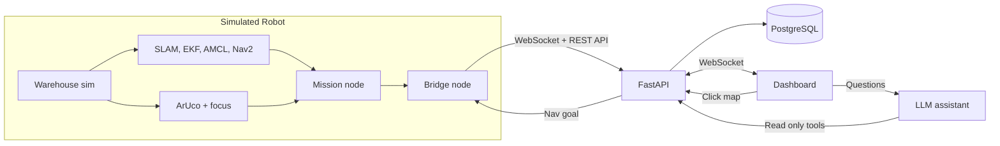

<div align="center">
  
  <h1>ROS 2 Warehouse Inspector</h1>
  <p>
    Simulated warehouse inspection robot automating inventory audits, built with ROS 2 Jazzy, Nav2 and Gazebo.
  </p>
<p>
  <a href="LICENSE">
    
  </a>
  <!-- ROS build and test
  <a href="https://github.com/Onafuwadav/ros2-warehouse-inspector/actions/workflows/ros.yml">
    
  </a>
  -->
  <!-- Backend tests
  <a href="https://github.com/Onafuwadav/ros2-warehouse-inspector/actions/workflows/backend.yml">
    
  </a>
  -->
  <!-- Dashboard build 
  <a href="https://github.com/Onafuwadav/ros2-warehouse-inspector/actions/workflows/dashboard.yml">
    
  </a>
  -->
  <!-- Docker 
  <a href="https://github.com/Onafuwadav/ros2-warehouse-inspector/actions/workflows/docker.yml">
    
  </a>
  -->
  <!-- Sim regression CI
  <a href="https://github.com/Onafuwadav/ros2-warehouse-inspector/actions/workflows/regression.yml">
    
  </a>
  -->
</p>

<!-- Live link
<h4>
    <a href="https://onafuwadav.github.io/ros2-warehouse-inspector/">Live dashboard demo</a>
  <span> · </span>
    <a href="docs/images/demo.mp4">Demo video</a>
</h4>
-->
</div>

## About The Project
Shelf audits done by hand are slow making them rare and causing inventory records to become inaccurate drift between them. This robot audits shelves on patrols and checks their markers and reports to a live web dashboard, with a grounded AI assistant for querying inspection data to speed up fault diagnosis


<details>
  <summary>System Architecture</summary>
  
This is the planned system architecture. See the Roadmap for what is built so far:



</details>

<details>
  <summary>Design Notes</summary>
  
- Parameter speed limits match real TurtleBot3 Waffle specifications (0.26 m/s, 1.82 rad/s)
- Robot footprint (0.22 m radius) matches the real TurtleBot3 Waffle
- 
</details>

<details>
  <summary>Screenshot</summary>
  
<div align="center">
  
</div>

</details>


### Tech Stack
[![C++][cpp-badge]][cpp-url] [![Python][py-badge]][py-url] <!-- M7 [![TypeScript][ts-badge]][ts-url] -->[![CMake][cmake-badge]][cmake-url] 

[![ROS 2][ros-badge]][ros-url] [![Gazebo][gazebo-badge]][gazebo-url] [![Nav2][nav2-badge]][nav2-url] <!-- M4: [![OpenCV][opencv-badge]][opencv-url] -->

[![GoogleTest][gtest-badge]][gtest-url] <!-- M6 [![pytest][pytest-badge]][pytest-url] M8: [![Docker][docker-badge]][docker-url] [![GitHub Actions][actions-badge]][actions-url] -->

<!-- M6: [![FastAPI][fastapi-badge]][fastapi-url] [![PostgreSQL][postgres-badge]][postgres-url] [![SQLAlchemy][sqlalchemy-badge]][sqlalchemy-url]  --> <!-- M7: [![React][react-badge]][react-url] -->


## Getting Started
 
### Prerequisites
- Ubuntu 24.04 with ROS 2 Jazzy and Gazebo Harmonic
- Nav2, slam_toolbox and TurtleBot3 sim packages:

  ```bash
  sudo apt install ros-jazzy-navigation2 ros-jazzy-nav2-bringup ros-jazzy-slam-toolbox \
    ros-jazzy-nav2-minimal-tb3-sim
  ```
  
<!-- M6 onwards:
- Docker Engine with the Compose plugin
- Node.js 20+ and Python 3.12 to run backend or dashboard outside of Docker
-->


<!-- Installation
### Installation
```bash
git clone https://github.com/Onafuwadav/ros2-warehouse-inspector.git
cd ros2-warehouse-inspector/ros2_ws
rosdep install --from-paths src --ignore-src -y
colcon build
source install/setup.bash
```
-->


<!-- Run Locally
### Run Locally
| Command | What it does |
|---|---|
| `ros2 launch inspector_bringup navigation.launch.py` | Launches warehouse, AMCL, Nav2 and RViz on the saved map |
| `ros2 launch inspector_bringup inspection.launch.py` | Starts all the inspection nodes and backend bridge |
| `docker compose up --build` | Builds images then starts the backend, database and dashboard |
| `colcon test && colcon test-result --verbose` | Runs unit tests and ROS linters |
-->


<!-- Usage
## Usage
### Run a patrol
```bash
ros2 action send_goal --feedback /inspect_shelves \
  inspector_interfaces/action/InspectShelves "{shelves: [shelf_B1, shelf_A1], laps: 1}"
```
An empty `shelves: []` visits every shelf
-->


## Results

All numbers below come from scripts in `eval/` which are re-run by `eval/run_all.sh` and then `eval/update_readme.py` updates the tables with each table ending with the commit SHA it came from

<details>
  <summary>Navigation over 10 laps</summary>

This data from `eval/nav_success.py` shows how reliable the robot is and how quickly it gets around. Each row shows data for a full patrol of all 16 waypoints then the last row is combined data

<!-- results:nav:start -->
| Lap | Waypoints attempted | Success rate (%) | Lap time (s) | Mean time to goal (s) | Max time to goal (s) | Mean dwell time per shelf (s) |
|---|---|---|---|---|---|---|
| tuned01 | 16 | 93.8 | 358.6 | 19.8 | 34.2 | 5.1 |
| tuned02 | 16 | 93.8 | 408.5 | 22.2 | 52.3 | 5.1 |
| tuned03 | 16 | 100.0 | 363.9 | 19.2 | 35.9 | 5.0 |
| tuned04 | 16 | 100.0 | 393.9 | 21.2 | 42.9 | 5.0 |
| tuned05 | 16 | 100.0 | 387.4 | 20.8 | 36.8 | 5.1 |
| tuned06 | 16 | 100.0 | 353.5 | 18.5 | 36.4 | 5.1 |
| tuned07 | 16 | 100.0 | 365.6 | 19.3 | 40.4 | 5.1 |
| tuned08 | 16 | 100.0 | 341.8 | 17.7 | 35.0 | 5.1 |
| tuned09 | 16 | 100.0 | 354.9 | 18.6 | 39.2 | 5.1 |
| tuned10 | 16 | 100.0 | 369.2 | 19.5 | 40.5 | 5.1 |
| **All laps** | 160 | 98.8 | 369.7 | 19.7 | 52.3 | 5.1 |

_From `eval/nav_success.py` at commit `69b8ee9`_
<!-- results:nav:end -->

</details>

<!-- M4
<details>
  <summary>Marker detection against camera blur</summary>

This data from `eval/detection_rate.py` shows at what point the robot stops reading the marker and that it reports BLURRY and not a false OK. Each row shows readings at each strength level of the blur injector
-->

<!-- results:detection:start -->
<!-- results:detection:end -->

<!-- M4
</details>
-->

<!-- M4
<details>
  <summary>Focus score and blur threshold</summary>

This data from `eval/focus_vs_blur.py` is evidence for the chosen focus threshold. Each row shows the images sharpness score data at each blur strength
-->

<!-- results:focus:start -->
<!-- results:focus:end -->

<!-- M4
</details>
-->

<!-- M4
<details>
  <summary>Perception latency</summary>

This data is from the timing logs in the detector and focus nodes over one patrol showing how long it takes to process each camera frame and checking the robot keeps up with the camera. This is checking if the processing time is longer than the time between each new frame the camera sends since if it is then the robot will fall behind, frames will queue up or get dropped, and the robot will react late. Each row shows readings at each processing stage: ArUco marker detection, Marker pose estimation, Image sharpness scoring
-->

<!-- results:latency:start -->
<!-- results:latency:end -->

<!-- M4
</details>
-->

<!-- M5
<details>
  <summary>Localisation error vs ground truth</summary>

This data is from `eval/localization_error.py` showing what is added to the raw odometry by EKF and AMCL. Each row compares one pose source against Gazebo's true pose over the same patrol
-->

<!-- results:localization:start -->
<!-- results:localization:end -->

<!-- M5
</details>
-->

<!-- Part E
<details>
  <summary>Regression gate</summary>

This data from `scenarios/` shows that a change making the robot worse is blocked before it merges. Each row is a scenario run on every PR and a screenshot showing the gate blocking a worse Nav2 change
-->

<!-- results:regression:start -->
<!-- results:regression:end -->

<!-- Part E
</details>
-->

<!-- Part D
<details>
  <summary>Assistant evaluation</summary>

This data is from `eval/assistant_eval.py` and shows that the assistant's answers are grounded in the data. Each row is a model asked 20 fixed questions about recorded runs
-->

<!-- results:assistant:start -->
<!-- results:assistant:end -->

<!-- Part D
</details>
-->


## Roadmap
 
- [x] Warehouse, robot spawn and teleoperation
- [x] SLAM map, Localisation (AMCL) and Nav2 tuning
- [x] Autonomous patrol with a unit tested mission state machine
- [x] Navigation success, recorded time to goal over 10 laps and ROS CI
- [ ] Camera, OpenCV ArUco detection and image sharpness check
- [ ] EKF localisation and localisation error checked against ground truth
- [ ] FastAPI/PostgreSQL telemetry backend and live React dashboard
- [ ] Docker, CI/CD and simulation regression tests
- [ ] Grounded LLM assistant for run analysis

## Contact
 
David Onafuwa: [LinkedIn](https://www.linkedin.com/in/david-onafuwa) · [Donafuwa@outlook.com](mailto:Donafuwa@outlook.com)

## Acknowledgments
- [TurtleBot3](https://github.com/ROBOTIS-GIT/turtlebot3) robot model
- [Nav2 minimal TurtleBot3 simulation](https://github.com/ros-navigation/nav2_minimal_turtlebot_simulation)
- [Nav2](https://github.com/ros-navigation/navigation2/blob/jazzy/nav2_bringup/params/nav2_params.yaml) default bringup parameters
- [Steve Macenski's](https://github.com/SteveMacenski/slam_toolbox/blob/jazzy/config/mapper_params_online_async.yaml) slam_toolbox config
- Badges from [shields.io](https://shields.io/)
<!-- 
M4
- ArUco detection and pose estimation: [OpenCV aruco module](https://docs.opencv.org/4.x/d5/dae/tutorial_aruco_detection.html).
- Tenengrad focus metric: E. Krotkov, *Focusing*, IJCV 1987; ported from my [autofocus](https://github.com/Onafuwadav/autofocus) project.

M5 
- EKF: [robot_localization](https://github.com/cra-ros-pkg/robot_localization) by Tom Moore and contributors.

M6-M7
- [FastAPI](https://fastapi.tiangolo.com/), [SQLAlchemy](https://www.sqlalchemy.org/) and [Alembic](https://alembic.sqlalchemy.org/) for the backend.
- [React](https://react.dev/) and [Vite](https://vite.dev/) for the dashboard.

M8
- Hosting: [Render](https://render.com/) (API), [Neon](https://neon.tech/) (Postgres), [GitHub Pages](https://pages.github.com/) (dashboard).

Part D
- Local model serving: [Ollama](https://ollama.com/).

Part F
- Recording and replay: [rosbag2](https://github.com/ros2/rosbag2)
-->

<!-- Tech Stack Badges -->
[ros-badge]: https://img.shields.io/badge/ROS_2-Jazzy-22314E?style=for-the-badge&logo=ros&logoColor=white
[ros-url]: https://docs.ros.org/en/jazzy/
[gazebo-badge]: https://img.shields.io/badge/Gazebo-Harmonic-F58113?style=for-the-badge
[gazebo-url]: https://gazebosim.org/
[nav2-badge]: https://img.shields.io/badge/Nav2-2E3440?style=for-the-badge
[nav2-url]: https://docs.nav2.org/
[cpp-badge]: https://img.shields.io/badge/C%2B%2B17-00599C?style=for-the-badge&logo=cplusplus&logoColor=white
[cpp-url]: https://isocpp.org/
[py-badge]: https://img.shields.io/badge/Python-3776AB?style=for-the-badge&logo=python&logoColor=white
[py-url]: https://www.python.org/
[cmake-badge]: https://img.shields.io/badge/CMake-064F8C?style=for-the-badge&logo=cmake&logoColor=white
[cmake-url]: https://cmake.org/
[gtest-badge]: https://img.shields.io/badge/GoogleTest-4285F4?style=for-the-badge&logo=google&logoColor=white
[gtest-url]: https://github.com/google/googletest
[opencv-badge]: https://img.shields.io/badge/OpenCV-5C3EE8?style=for-the-badge&logo=opencv&logoColor=white
[opencv-url]: https://opencv.org/
[fastapi-badge]: https://img.shields.io/badge/FastAPI-009688?style=for-the-badge&logo=fastapi&logoColor=white
[fastapi-url]: https://fastapi.tiangolo.com/
[postgres-badge]: https://img.shields.io/badge/PostgreSQL-4169E1?style=for-the-badge&logo=postgresql&logoColor=white
[postgres-url]: https://www.postgresql.org/
[sqlalchemy-badge]: https://img.shields.io/badge/SQLAlchemy-D71F00?style=for-the-badge&logo=sqlalchemy&logoColor=white
[sqlalchemy-url]: https://www.sqlalchemy.org/
[pytest-badge]: https://img.shields.io/badge/pytest-0A9EDC?style=for-the-badge&logo=pytest&logoColor=white
[pytest-url]: https://docs.pytest.org/
[ts-badge]: https://img.shields.io/badge/TypeScript-3178C6?style=for-the-badge&logo=typescript&logoColor=white
[ts-url]: https://www.typescriptlang.org/
[react-badge]: https://img.shields.io/badge/React-20232A?style=for-the-badge&logo=react&logoColor=61DAFB
[react-url]: https://react.dev/
[docker-badge]: https://img.shields.io/badge/Docker-2496ED?style=for-the-badge&logo=docker&logoColor=white
[docker-url]: https://www.docker.com/
[actions-badge]: https://img.shields.io/badge/GitHub_Actions-2088FF?style=for-the-badge&logo=githubactions&logoColor=white
[actions-url]: https://github.com/features/actions
